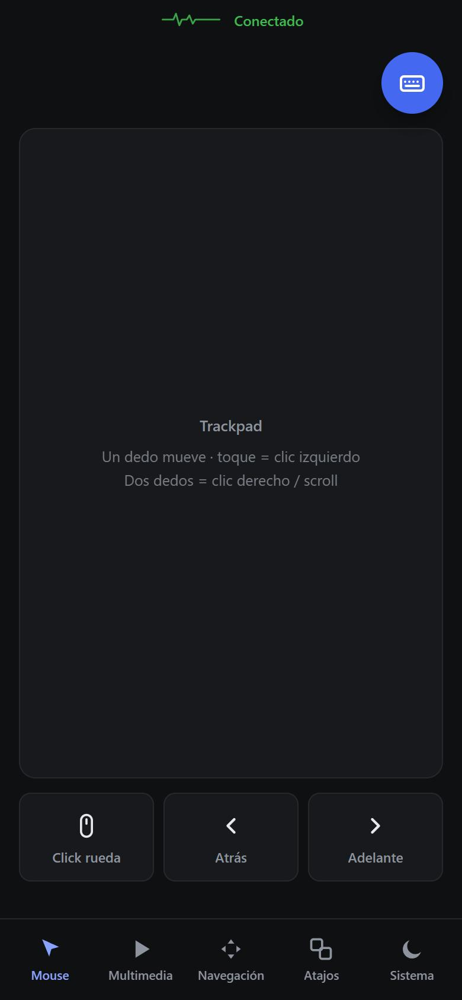
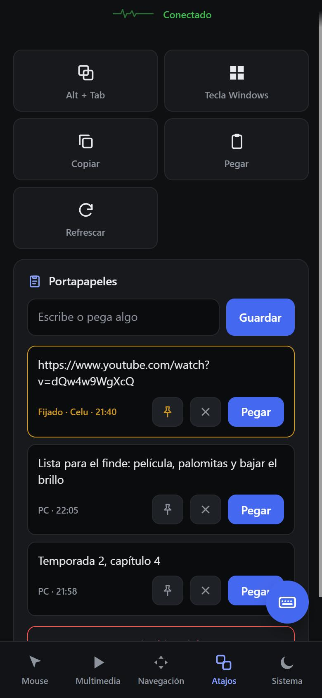
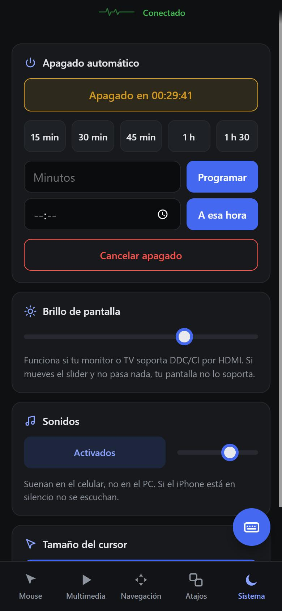

# Cursor Remoto

Control remoto personal de mouse y teclado para tu PC con Windows desde el celular, pensado para usar el PC como "tele" desde la cama.

<p align="center">
  
  
  
</p>

## Instalar

Solo para **Windows 10/11**. El celular puede ser iPhone o Android; no necesita instalar nada.

1. Descarga **`CursorRemoto-Setup-<versión>.exe`** desde la [última versión](https://github.com/matiTCP/cursor-remoto/releases/latest).
2. Ábrelo. Como el instalador no está firmado, Windows muestra "Windows protegió tu PC": toca **Más información → Ejecutar de todas formas**.
3. Acepta el permiso de administrador. Se usa para instalar en Archivos de programa y permitir la conexión del celular en el Firewall (solo en redes privadas).
4. Al terminar se abre Cursor Remoto con un **código QR**. Con el celular conectado al **mismo WiFi** que el PC, escanéalo con la cámara y listo.
5. En el iPhone, toca **Compartir → Agregar a pantalla de inicio** para tenerlo como app. Esa app pide el **PIN** que aparece en la ventana del PC.

La app queda en la bandeja del sistema (junto al reloj); cerrar la ventana no la apaga. En su ventana puedes activar **Iniciar con Windows**, cambiar el PIN y ver o desvincular los celulares conectados.

Si el celular no conecta, revisa que Windows tenga tu WiFi como **red privada** (Configuración → Red e Internet → tu red → Tipo de perfil de red). En redes públicas el Firewall bloquea la conexión.

## Cómo funciona

- Un servidor Node.js (`server.js`) corre en tu PC y expone una página web + WebSocket en tu red local.
- Un agente en PowerShell (`agent/input-agent.ps1`) traduce los comandos recibidos en movimientos de mouse y teclas reales, usando solo APIs de Windows (sin instalar nada extra ni compilar módulos nativos).
- Desde el iPhone abres la IP de tu PC en Safari y tienes un trackpad táctil, teclado nativo y una grilla de botones personalizables.

## Usarlo desde el código

Si prefieres no instalar nada y tienes Node.js:

```bash
npm install
npm start
```

La consola va a mostrar algo como:

```
Cursor Remoto escuchando en el puerto 5577
  -> Abre desde el celular (misma red WiFi): http://192.168.x.x:5577
```

1. Conecta el iPhone a la **misma red WiFi** que el PC.
2. Abre esa dirección en Safari.
3. Ingresa el PIN (por defecto `1234`). La primera vez que arranca, el servidor crea `config.json` copiando `config.example.json`; cambia el PIN ahí. `config.json` no se sube al repo.
4. Toca **Compartir → Agregar a pantalla de inicio** en Safari para tener un ícono como si fuera una app.

Si Windows pregunta si permitir el acceso de Node.js a la red (Firewall de Windows), elige **Permitir** (al menos para redes privadas).

## App de escritorio (beta)

Es lo que trae el instalador. Desde el código, en vez de la consola, puedes correr la app de escritorio, que usa el mismo servidor con una ventana y un ícono en la bandeja del sistema:

```bash
npm install
npm run desktop
```

- Muestra un **código QR** para abrir la app en el celular escaneándolo, la dirección para copiar y, si el PC tiene varias redes (WSL, VPN…), un selector de cuál usar.
- **Emparejar escaneando el QR**: el QR lleva un código de emparejamiento que se renueva cada 10 minutos (una foto vieja del QR no sirve), así que el celular queda conectado sin escribir nada. El PIN queda como alternativa (por ejemplo, para la app agregada a la pantalla de inicio del iPhone, que no comparte datos con Safari).
- Lista de **dispositivos emparejados**, con botón para olvidar uno o todos (se desconectan al instante).
- Permite **cambiar el PIN** (no afecta a los ya emparejados), el puerto, **iniciar con Windows** y activar o desactivar el historial del portapapeles. Si el PIN es el de ejemplo (`1234`), la app lo reemplaza por uno al azar.
- Cerrar la ventana la deja en la bandeja; para salir del todo: clic derecho en el ícono → Salir.
- Su configuración vive en `%APPDATA%\Cursor Remoto\config.json` (separada del `config.json` del repo, que sigue usando `npm start`). La primera vez copia el `config.json` del repo si existe, o la configuración de `%APPDATA%\Mouse Final` si venías de la versión anterior.
- El código está en `desktop/` (Electron) y el servidor compartido en `src/server.js`.

### Generar el instalador

```bash
npm run dist
```

Crea `dist/CursorRemoto-Setup-<versión>.exe`, un instalador de Windows que trae todo adentro (el usuario no necesita Node.js). Al instalar:

- Pide permiso de administrador una vez, para instalar en Archivos de programa y agregar la regla del Firewall de Windows (solo redes privadas), así no aparece el aviso al abrir la app.
- Crea accesos directos en Inicio y Escritorio, y abre la app al terminar.
- Al desinstalar, se borran la regla del Firewall y el inicio automático. La configuración y los dispositivos emparejados (`%APPDATA%\Cursor Remoto`) se conservan por si se reinstala.

El instalador no está firmado: Windows SmartScreen muestra "Windows protegió tu PC" → **Más información** → **Ejecutar de todas formas**. Para quitar ese aviso hace falta un certificado de firma de código.

La configuración de empaquetado está en `package.json` (`"build"`) y los pasos extra del instalador en `build/installer.nsh`.

## Estética

Tema oscuro minimalista con un solo color de acento. El indicador de conexión es un pequeño electrocardiograma:

- **Verde, latiendo**: conectado
- **Ámbar**: conectando o esperando el PIN
- **Rojo**: sin conexión o PIN incorrecto

Los colores y medidas están en `tokens.json`. Después de cambiar algo ahí, corre `npm run tokens` para regenerar `public/tokens.css`. `style.css` solo usa esas variables.

El ícono se genera con `scripts/make-icon.ps1`:

```powershell
./scripts/make-icon.ps1 ./public/icon-512.png 512
```

Si cambias el ícono, sube el `?v=N` de los íconos en `index.html` y `manifest.json`, y en el iPhone borra el acceso directo y agrégalo de nuevo (iOS guarda el ícono viejo).

## Controles

- **Trackpad:** un dedo mueve el cursor, toque = clic izquierdo, dos dedos = clic derecho (toque) o scroll (arrastrar).
  - El scroll con dos dedos manda "clics" de rueda completos (120, como una rueda real), uno cada 22 px de dedo (`PX_PER_NOTCH` en `app.js`). Dedos hacia arriba = la página sube, como en el iPhone.
  - Mientras haya dos dedos el gesto queda en modo scroll hasta soltar todo, así el cursor no salta si levantas un dedo antes que el otro.
- **Teclado:** el botón del teclado (en Mouse va arriba del trackpad; en las otras pestañas, abajo a la derecha) abre un campo de texto. Lo que escribas se envía en tiempo real (soporta tildes y ñ).
  - Se escribe simulando la tecla real del layout de Windows (`VkKeyScanEx` + `keybd_event`), no con "paquetes Unicode", porque muchos juegos y reproductores a pantalla completa ignoran esos últimos.
  - El campo se mantiene relleno con caracteres invisibles (espacio de ancho cero). Sin eso, apretar "borrar" con el campo vacío no genera ningún evento en iOS y no habría forma de borrar texto que ya estaba escrito en el PC.
  - Además hay botones **⌫ Borrar** (se puede mantener presionado) y **Borrar todo** (manda `Ctrl+A` y luego borrar), como respaldo.
- **Botones personalizados:** Play/Pausa, Volumen +/-, Silenciar, Esc, F (pantalla completa), flechas, clic de rueda y los botones laterales del mouse (atrás/adelante).

## Apagado automático

En **Sistema → Apagado automático** puedes:

- Tocar un preset (15 / 30 / 45 / 60 / 90 min).
- Poner minutos personalizados.
- Programarlo para una hora específica (si esa hora ya pasó hoy, se programa para mañana).
- Ver la cuenta regresiva en vivo y cancelarlo en cualquier momento.

Programar y cancelar piden confirmación, para que no pase por un toque accidental. Internamente usa `shutdown /s /t <segundos>` (y `shutdown /a` para cancelar), acotado entre 10 segundos y 24 horas. El estado se sincroniza entre todos los dispositivos conectados.

## Portapapeles

En la pestaña **Atajos** hay un historial del portapapeles del PC:

- **Todo el texto que copies en el PC** (Ctrl+C, clic derecho → Copiar, o el botón Copiar de la app) se guarda solo, lo más nuevo arriba. Copiar algo que ya estaba lo sube arriba en vez de duplicarlo.
- **Pegar** pone ese texto en el portapapeles del PC y manda Ctrl+V, así que se pega donde esté el cursor.
- **Guardar** agrega texto escrito o pegado desde el celular (por ejemplo, un link que copiaste en el iPhone) para pegarlo en el PC.
- **Fijar** deja un elemento arriba. "Vaciar historial" borra todo menos lo fijado y pide confirmación.
- Guarda hasta 60 elementos (más los fijados), de hasta 20.000 caracteres cada uno. Solo texto.

Cómo funciona: `agent/clipboard-watch.ps1` corre aparte, mira cada 400 ms el contador de cambios del portapapeles de Windows (`GetClipboardSequenceNumber`) y solo lee el texto cuando cambió. Para pegar se usa el comando `CLIP|<base64>` del agente de entrada.

Privacidad:

- El historial se guarda en `%LOCALAPPDATA%\MouseFinal\clipboard.json`, **fuera de la carpeta del proyecto**, para que no termine sincronizado en la nube.
- Lo que los gestores de contraseñas marcan como "no guardar en historial" (el mismo criterio que usa Win+V) **no** se guarda.
- El historial viaja sin cifrar por tu WiFi hacia el celular. Solo lo reciben dispositivos que pusieron el PIN.

## Sonidos

Sonidos cortos de menú (`public/sfx.js`), **sintetizados con Web Audio**, sin archivos de audio:

| Sonido | Cuándo suena |
|---|---|
| `cursor` (pip corto) | cambiar de pestaña, flechas, Vol +/-, ⌫, mover sliders |
| `select` (click + dos pips) | botones, OK, confirmar, PIN correcto |
| `cancel` (dos pips bajando) | cancelar, "Listo" del teclado, "Borrar todo" |
| `open` (golpe + deslizamiento) | abrir la ventana de confirmación o el teclado |
| `error` (zumbido grave) | PIN incorrecto, "A esa hora" sin hora |

Se activan, desactivan y ajustan en **Sistema → Sonidos** (se guarda en el celular). Suenan en el celular, no en el PC.

Para usar sonidos propios, pon los archivos en `public/sfx/` y anótalos en `public/sfx/index.json`, por ejemplo `{ "cursor": "cursor.mp3" }`.

## Otras funciones

- **Pantalla siempre despierta** mientras la página está abierta (Wake Lock API; si no está disponible, no pasa nada).
- **Mantener presionado para repetir** en las flechas y Vol +/-.
- **Atajos:** Alt+Tab, tecla Windows, Copiar, Pegar y Refrescar. Puedes agregar más en `config.json` con `"code": "MOD1+MOD2+TECLA"` (ej. `"CTRL+SHIFT+ESCAPE"`), siempre que las teclas estén en el mapa de `agent/input-agent.ps1`.
- **Volumen:** slider aproximado (simula pulsaciones de Vol +/-), no lee el volumen real.
- **Tamaño del cursor:** Windows no deja cambiarlo a distancia de forma confiable, así que hay un botón que abre la pantalla de ajustes.
- **Brillo de pantalla:** usa DDC/CI vía HDMI (`Dxva2.dll`). Funciona si tu monitor o TV lo soporta.

## Personalizar los botones

Edita `config.json`. Cada botón tiene esta forma:

```json
{ "label": "Nombre", "icon": "play", "category": "multimedia", "action": { "type": "key", "code": "ESCAPE" } }
```

Tipos de `action`:

- `{"type":"key","code":"..."}`: `ESCAPE`, `F`, `UP`, `DOWN`, `LEFT`, `RIGHT`, `BACKSPACE`, `ENTER`, `VOLUME_UP`, `VOLUME_DOWN`, `VOLUME_MUTE`, `MEDIA_PLAY_PAUSE`, `BROWSER_BACK`, `BROWSER_FORWARD`, o combos como `CTRL+C`.
- `{"type":"click","button":"..."}`: `left`, `right`, `middle`, `x1` (lateral atrás), `x2` (lateral adelante).

Guarda el archivo y refresca la página del celular; no hace falta reiniciar el servidor.

## Temas

Puedes tener tu propio tema sin tocar `public/`:

1. Crea `themes/<nombre>/` con solo los archivos que quieras cambiar (`index.html`, `style.css`, `tokens.css`, `theme.js`, imágenes, íconos…). Lo que no esté ahí se toma de `public/`.
2. `theme.js` define los textos que muestra la app (estado de conexión, apagado, portapapeles). Copia `public/theme.js` y cambia los textos.
3. Pon `"theme": "<nombre>"` en `config.json` y reinicia el servidor.

Tu tema queda en `/` y la versión base sigue disponible en `/base/`. La carpeta `themes/` está en `.gitignore`, así que tus temas no se suben al repo.

Con la app de escritorio **instalada**, los temas van en `%APPDATA%\Cursor Remoto\themes\<nombre>\` y el `"theme"` en `%APPDATA%\Cursor Remoto\config.json` (la app instalada no puede escribir en su propia carpeta). Después de cambiarlo, detén e inicia el servidor desde la ventana.

Para generar el `tokens.css` de un tema desde su propio `tokens.json`:

```bash
node scripts/build-tokens.js themes/<nombre>/tokens.json themes/<nombre>/tokens.css
```

## Arranque automático con Windows

```powershell
./scripts/install-autostart.ps1
```

Crea un acceso directo silencioso en la carpeta de Inicio que arranca el servidor sin ventana cada vez que inicias sesión. Para quitarlo:

```powershell
./scripts/uninstall-autostart.ps1
```

## Seguridad

- Pensado para tu red WiFi doméstica, no para exponerlo a internet.
- Cambia el PIN en `config.json` (o desde la app de escritorio): cualquiera en tu WiFi que sepa la IP y el puerto podría intentar conectarse.
- El celular guarda un **token de dispositivo**, no el PIN. En el PC solo se guarda su hash (`devices.json`).
- **Límite de intentos**: después de 5 PIN o QR incorrectos desde una misma IP se bloquea 30 s, y cada fallo extra duplica la espera (hasta 15 min).
- No lo publiques con port-forwarding en el router sin agregar HTTPS y una autenticación más fuerte.

## Licencia

[MIT](LICENSE).
